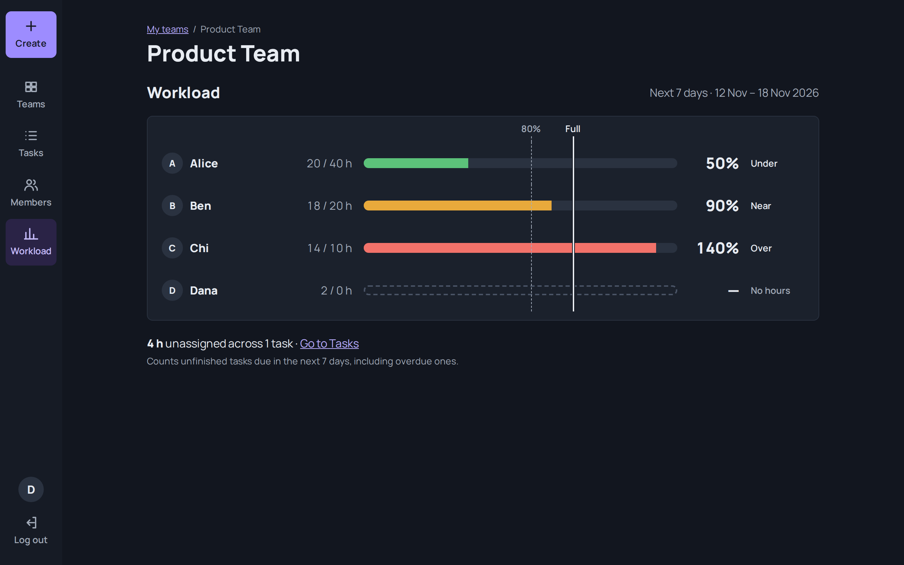
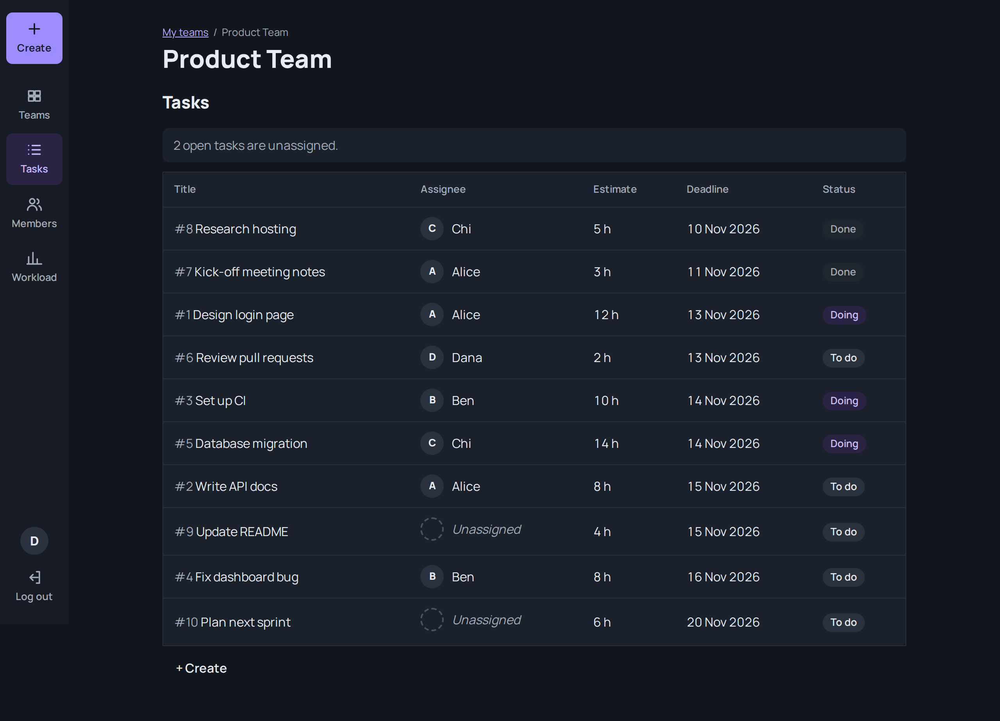
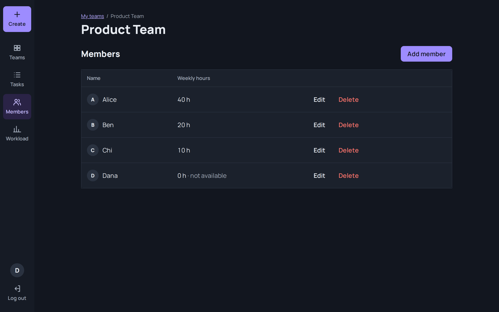

# Team Capacity Tracker

A web app that shows a team lead, at a glance, **who on the team has too much work and who has room to take more**.

**Live app:** https://team-capacity-tracker-app.onrender.com/



## Why I built it

I worked in a university project team three times. A bad teammate is easy enough to fix: you
ask the tutor to move teams. A team where **nobody knows what to do, or when**, is much harder.
I ended up planning everything myself, and some teammates who had done very little still got the
same mark as everyone else, because nobody could see who did what.

This app is for that situation. It gives a student team, or any small to medium team (about 3–8
people), one shared view of who owns which tasks, how many hours that adds up to, and who is
overloaded. The lead can then act on the timeline early, instead of finding out in the last week.

## Try it

1. Open the [live app](https://team-capacity-tracker-app.onrender.com/) and **sign up** with an
   email and password.
   > There is no "forgot password" option yet, so use a password you will remember.
2. Create a team.
3. Add your teammates (and yourself), each with the hours they can give per week.
4. Add tasks, Jira-style: title, hour estimate, deadline, assignee and status (To do / Doing / Done).
5. Open **Workload** to see whether everyone's share of the work is fair and realistic.

## Features

- Sign up and log in; each user only ever sees their own teams
- Create teams, and add, edit and delete members with their weekly available hours
- Add, edit and delete tasks with an estimate, deadline, assignee and status
- Tasks of a deleted member are kept and become **Unassigned**
- Workload dashboard: one bar per member, coloured by how loaded they are
- Empty, loading and error states on every screen, and a "not found" page

| Tasks | Members |
|---|---|
|  |  |

## How the workload is calculated

For each member: **load = hours of their unfinished tasks due in the next 7 days ÷ their weekly
available hours**. Overdue unfinished tasks count too, since that work still has to be done.

| Load | Bar | Meaning |
|---|---|---|
| under 80% | green | Has room |
| 80–100% | amber | Near capacity |
| over 100% | red | Overloaded, rebalance |
| member has 0 weekly hours | grey "No hours" | Shown as overloaded if they have any work |

The calculation is a single pure function, [`server/src/load.js`](server/src/load.js), with unit
tests for every threshold and the 0-hour case.

## Tech stack

| Part | Choice |
|---|---|
| Front end | React 19 + Vite, React Router |
| Back end | Node.js + Express 5, REST API with JSON |
| Database | PostgreSQL (hosted on Neon) |
| Auth | bcrypt password hashes, JSON Web Tokens |
| Tests | Vitest |
| Hosting | Render (client and API), Neon (database) |

```
Browser (React) → API server (Express) → Database (PostgreSQL)
```

- **React** handles the pages, forms and dashboard.
- **Express** handles login, input validation, ownership checks and the load calculation. Asking
  for another user's team, member or task returns **404**, so nobody can tell which ids exist.
- **PostgreSQL** stores users, teams, members and tasks
  ([`server/schema.sql`](server/schema.sql)).

## Running locally

Requires Node (current LTS) and PostgreSQL.

**1. Database**

```bash
createdb team_capacity
psql team_capacity -f server/schema.sql
psql team_capacity -f server/seed.sql   # optional sample data
```

**2. API** (http://localhost:3001). Create `server/.env`:

```
PORT=3001
CLIENT_ORIGIN=http://localhost:5173
DATABASE_URL=postgresql://<user>@localhost/team_capacity
JWT_SECRET=<any long random string>
```

```bash
cd server
npm install
npm run dev
```

Check it is up: `GET http://localhost:3001/api/health` returns `{ "status": "ok", "db": "ok" }`.

**3. Client** (http://localhost:5173), in a second terminal. Create `client/.env`:

```
VITE_API_URL=http://localhost:3001
```

```bash
cd client
npm install
npm run dev
```

## Running the tests

```bash
cd server
npm test
```

## Known limitations

- **Estimates, not real work.** The app tracks hours and status, not whether work has really
  started. If the whole team waits until the deadline, every bar stays green until it is too late.
- **Only as good as its updates.** If tasks are not moved to Doing or Done, the dashboard gives a
  false sense of safety.
- **Visibility, not motivation.** It shows who is overloaded or idle; it cannot make anyone do
  their share. That is a team and leadership problem, not a software one.
- **Not a code workflow.** It does not replace branches and pull requests; it only tracks who owns
  what and for how many hours.
- **Desktop first.** The layout is built for desktop and has not been designed for phone screens.
- **No password reset** yet.

## What I would add next

- Phone-friendly layout
- Password reset
- Deadline-risk warning: flag tasks whose remaining hours don't fit before the deadline
- Spread a task's hours across the weeks until its deadline
- Member skills, and a suggested assignee (right skill and most free hours)
- Invite teammates with roles (lead can edit, members can view)

## Project structure

```
├── client/                 React front end
│   └── src/
│       ├── api/            fetch wrapper for the REST API
│       ├── auth/           login state and protected routes
│       ├── components/     shared UI (workload bar, modal, dialogs, states)
│       └── pages/          one file per screen or form
└── server/                 Express API
    ├── schema.sql          tables and constraints
    ├── seed.sql            sample data
    └── src/
        ├── load.js         workload calculation (+ load.test.js)
        └── routes/         auth, teams, members, tasks, workload
```

## About

Built by **Nguyen Do Nhat Hoang** ([@HoangNeHello](https://github.com/HoangNeHello)), from
October 2026, as a portfolio project for junior full-stack developer roles. I built it with
Claude Code as an AI pair programmer: I set the scope and rules, made the design decisions, and
reviewed every change before it was merged.
